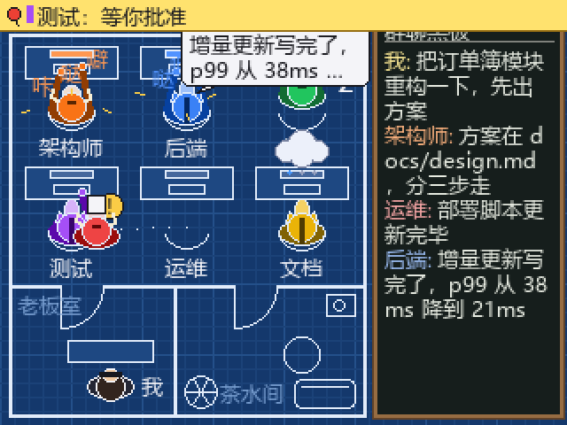
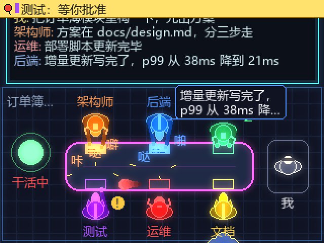
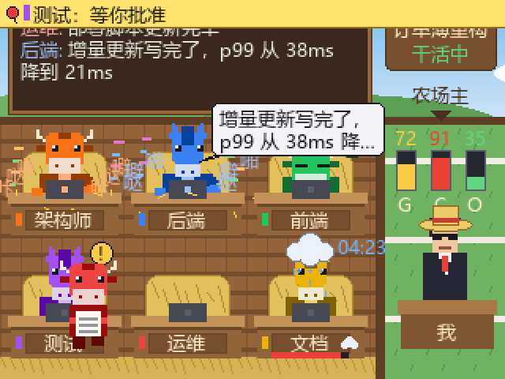
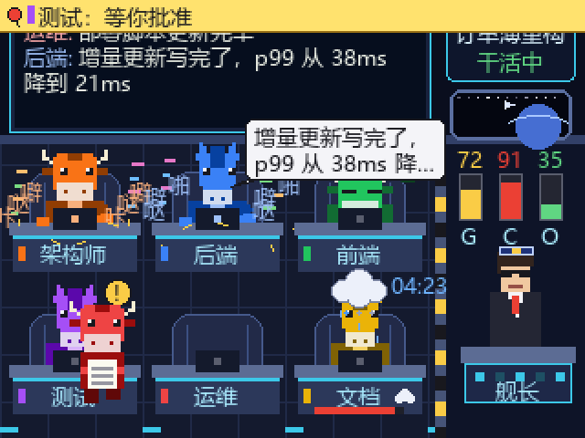
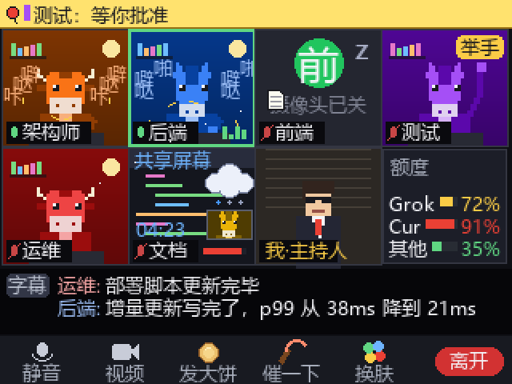
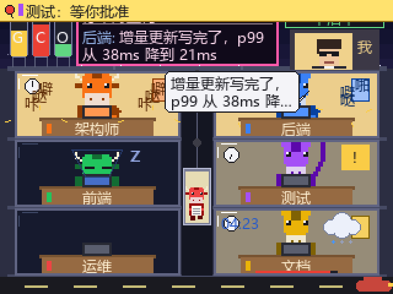
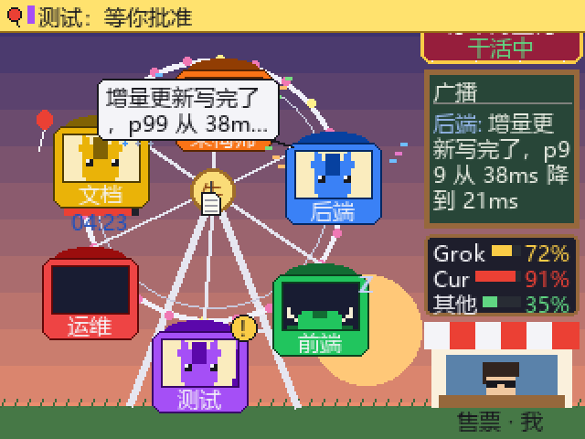
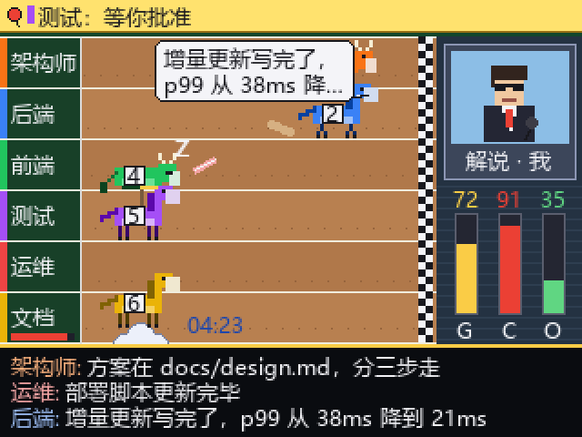

# 牛马办公室：把 Alarmo 变成 Grok Bot 群聊的工位监控

把 Grok Bot 群聊里的每个 bot 画成一只坐在工位上的牛或马，在一块 320×240 的小屏上实时显示谁在干活、谁在睡、谁在等你批准；按一下键就能催进度、发大饼，点一下牛马就能私聊盯它，按住还能直接说话。


目录：[能做什么](#能做什么) · [主题预览](#主题预览) · [整体结构](#整体结构) · [部署教程](#部署教程) · [怎么操作](#怎么操作) · [功能细节](#功能细节) · [配置参考](#配置参考) · [命令行与接口](#命令行与接口) · [常见问题](#常见问题) · [验证状态](#验证状态)

> ## ⚠️ 先确认你的 Alarmo 能装第三方固件
>
> 闹钟端靠上游的「USB 载入」漏洞运行自制固件，**Nintendo 已经把这条路堵了**：
>
> - 系统 **v3.0.0 及以后**（含 v4.0.0）：USB 载入已被修补；
> - 系统显示 v2.0.0、但**较新出厂的机器**（设置里 v2.0.0 下面的校验串是 `c74976c35f`）：出厂带的启动加载器也修了签名检查，同样载入不了；
> - 只有**早期出厂、且没有升级过**的 v1.x / v2.0.0 机器才可能成功。
>
> 这些机器上表现都一样：按住三个键插 USB、拷完 `a.bin` 和 `MarkFile`，U 盘断开、闹钟重启，**回到原厂系统，不出现小猫**。依据见上游 Issues：[#11](https://github.com/GaryOderNichts/alarmo/issues/11)（维护者确认 v3.0.0 修补）和 [#14](https://github.com/GaryOderNichts/alarmo/issues/14)（v2.0.0 新出厂机器同样失败）。
>
> 检查方法：闹钟「设置」里看系统版本和那串校验码。**不要为了试一试去升级系统**，升级不可逆。
> 装不了也没关系：hub、桥接、网页模拟器完全不受影响；屏幕可以换成 **M5Stack Core2**（已实现，见 [第 4' 步](#4-用-m5stack-core2-当屏幕)）或任意浏览器，见 [没有可装固件的 Alarmo 怎么办](#没有可装固件的-alarmo-怎么办)。

---

## 能做什么


**看状态**

- 每个 bot 是一只牛或马，颜色和 Grok Bot 里它的头像一致，名字在工位上。
- 在干活就狂敲键盘，空闲久了趴桌睡觉，等你批准就举手。
- A 的消息里 @ 了 B，A 会抱着文件把活交给 B（不同主题动画不同：走过去、坐电梯、扔接力棒……）。
- 群里的话写在黑板上，说话的人头顶冒气泡；bot 私聊你时走到你身边说悄悄话（虚线气泡，不上黑板）。
- 超过 3 分钟没动静且没人干活：全员睡觉、屏幕红框闪烁、顶栏显示卡住多久。
- **公告**：哪只牛马在等你批准，屏幕顶上挂一条黄色公告，写着它要批准什么。
- **额度**：Grok Bot 每周额度、Cursor 模型、其他模型三项常驻显示，越过 80% / 95% 提醒，用完全员趴桌。
- **外包**：指定的 Cursor 云端任务在跑时，云端 bot 头顶飘一朵云并计时，干完了包裹从云里掉下来。

**动手**

- **大按钮 = 抽鞭子**：整屏一闪、全员跳起来惊慌狂敲，同时往群里发一句催进度的话。
- **左上键 = 发大饼**：老板挨个走到每个人面前递饼，同时往群里发「大家辛苦了」。
- **右上键 = 换肤**：8 套主题轮换。
- **点一下某只牛马 = 点名**：老板跑过去盯着它说「干活，我在盯着你」，同时真的私聊它这句话；它私聊回你的话直接冒在它头顶。
- **按住牛马 / 按住「我」= 说话**：用你手上的手机、电脑或 Core2 录音，松手后由 Grok Bot 听写成文字，私聊它或发到群里。

## 主题预览

在 `hub/config.toml` 的 `[render] theme` 里选默认主题，运行中按右上键或在网页模拟器里点按钮切换。

| | |
|---|---|
| **`blueprint` A 建筑蓝图**<br>纯俯视平面图，右侧竖黑板<br> | **`neon` B 夜班作战室**<br>霓虹俯视，大家围着会议桌<br> |
| **`barn` C 牛马牧场**<br>草垛当椅背的牛棚，右边院子里戴草帽的农场主<br> | **`space` D 太空舰桥**<br>座舱椅 + 全息屏，右边舰长台和舷窗<br> |
| **`meeting` E 视频会议**<br>4×2 摄像头宫格，黑板是底部实时字幕，底栏按钮对应三个实体键<br> | **`tower` F 加班写字楼**<br>夜景大楼剖面，3 层 × 2 间，中间电梯井，楼顶霓虹广告牌<br> |
| **`wheel` G 牛马摩天轮**<br>轿厢绕圈转，干活的人越多转得越快，卡住就停<br> | **`derby` H KPI 赛马场**<br>一人一条赛道，跑多远 = 最近 30 分钟有多活跃<br> |

各主题里同一件事的样子：

| 主题 | 悄悄话 | 交接 | 发大饼 | 额度常驻显示 |
|---|---|---|---|---|
| 建筑蓝图 | 走进老板室凑到你身边 | 走过去送文件 | 老板走一圈 | 黑板底部横条（隐藏聊天时） |
| 夜班作战室 | 滑到你的座位旁 | 数据包飞过桌面 | 老板绕桌一圈 | 黑板底部横条（隐藏聊天时） |
| 牛马牧场 / 太空舰桥 | 走到农场主 / 舰长身边 | 走过去送文件 | 老板走一圈 | 右侧三根竖条 |
| 视频会议 | 字幕栏盖一条「私聊 → 我」横幅 | 文件在两格之间飞，对方亮「收到文件」 | 饼从「我」的格子飞过去 | 单独一格「额度」 |
| 加班写字楼 | 给楼顶老板打电话 | 走进电梯坐到对方楼层 | 老板坐电梯一层层下来 | 楼顶三个水箱（水位 = 用量） |
| 牛马摩天轮 | 对讲机虚线连到售票亭 | 文件顺着辐条滑过去 | 把对方轿厢转到站台再递饼，放烟花 | 广播牌下面一块牌子 |
| KPI 赛马场 | 掉头跑到看台边 | 扔接力棒 | 老板从解说台往赛道扔 | 解说台下三根竖条 |

状态的样子：干活 = 狂敲 / 狂奔；睡觉 = 趴桌、关摄像头、关灯或趴在跑道上；待批 = 「!」、举手、黄便签或小黄旗。

`neon` 的辉光让画面最复杂，在全速 USB 上每帧约 60 KB（其它主题 10~50 KB），帧率会低一些。

## 整体结构

```
你手上：手机 / 电脑浏览器、M5Stack Core2、Alarmo        ← 看画面、按键、点牛马、按住说话
                 │  HTTP(S) / USB 串口
                 ▼
hub/hub.py（Windows / Debian / 树莓派）                  ← 状态 + 画面渲染 + 网页模拟器 + 驱动闹钟
                 ▲  HTTP
                 │
bridge/bridge.py（装着 Grok Bot 桌面端的 Windows）        ← 读 Grok Bot 界面、代发消息、私聊、听写
```

- **桥接**（`bridge/`）：用 Windows 的 UI 自动化读 Grok Bot 窗口里的群聊、bot 状态、头像颜色，按 hub 的指令往群里发话、私聊某个 bot、触发 Grok 的听写；另外用你的 Cursor 登录 Cookie 调只读接口查额度和云端任务。
- **hub**（`hub/`）：维护办公室状态，每秒 20 帧渲染 320×240 的画面，通过 USB 串口推给 Alarmo、通过 `/frame.jpg` 给 Core2、通过 MJPEG 给浏览器；同时提供网页模拟器。
- **屏幕**：Alarmo 固件（`firmware/`）、Core2 固件（`m5core2/`）或任意浏览器。

---

## 部署教程

### 0. 先选一种部署方式

hub 和桥接只靠 HTTP 通信，放哪都行：

| 方式 | 适合 | 怎么放 |
|---|---|---|
| **A. 全部装在这台 Windows** | 最简单，推荐先用这个 | 桥接和 hub 都在装 Grok Bot 的电脑上，`hub` 地址写 `127.0.0.1` |
| **B. 桥接在 Windows，hub 在 Debian / 树莓派** | 想让屏幕放在别处、7x24 运行 | 桥接的 `hub` 地址写 Debian / 树莓派的内网 IP |
| **C. B 的虚拟机版** | hub 在 ESXi 的 Debian 虚拟机里 | 见 [第 6 步](#6-esxi--虚拟机的-usb-直通) |

你需要准备：

- 装好 **Grok Bot 桌面端**的 Windows（Win10 / 11），已登录、打开了要监控的群聊；
- **Python 3.9 以上**（3.11 以上最好；更低版本自动用 `tomli` 代替内置的 `tomllib`）；
- 屏幕三选一：能装第三方固件的 Alarmo + 能传数据的 USB 线 / M5Stack Core2 / 任意浏览器；
- 想用「按住说话」：在装 Grok Bot 的电脑上装虚拟声卡 VB-CABLE（[第 7 步](#7-可选按住说话)，有一键脚本）。

> 只想先看效果：做完第 1 步就够了，模拟器页面就是一台虚拟闹钟。

### 1. 先看效果（不需要闹钟和桥接）

**Windows（PowerShell 或 cmd）**

```bat
cd alarmo-niuma
pip install -r hub\requirements.txt -r bridge\requirements.txt
cd hub
python hub.py --demo --no-device
```

**Debian / 树莓派 OS**

```bash
sudo apt install python3-aiohttp python3-pil python3-numpy python3-serial fonts-wqy-microhei openssl
cd alarmo-niuma/hub
python3 hub.py --demo --no-device
```

浏览器打开 `http://localhost:8765/`。页面里是一台画出来的 Alarmo，用的是假数据：

- 红色大按钮：按一下 = 抽鞭子；左右拖动或滚轮 = 转动滚轮（看聊天记录 / 额度页）；
- 左上「鼓励」、右上「换肤」；键盘：<kbd>空格</kbd> 大按钮、<kbd>E</kbd> 鼓励、<kbd>T</kbd> 换肤、<kbd>←</kbd><kbd>→</kbd> 转动；
- 点画面上的牛马 = 点名，按住 = 说话（演示模式下不会真的发出去）；
- 页面下方可以切主题、勾选「显示聊天内容」、注入一条消息（写 `@名字` 触发交接，勾「私聊我」看悄悄话）。

> Windows 用微软雅黑，基本不会缺中文字体；Debian 缺字体时 hub 会提示安装 `fonts-wqy-microhei`。

### 2. 配置并校准桥接（Windows）

**2.1 保持窗口可读**

Grok Bot 是 Electron 应用，界面文字靠 Windows 的 UI 自动化读取。两条硬性前提：

- **窗口不能最小化**（最小化时 Chromium 不生成界面树，什么都读不到）。可以被别的窗口盖住，也可以放在副屏；
- 电脑**不能锁屏**，远程桌面不能断开（这种状态下 Windows 不允许模拟按键，往群里发消息会失败）。

**2.2 改 `bridge/config.toml`**

第一次运行 `bridge.py` 时会从 `config.example.toml` 自动复制出 `config.toml`（hub 也一样）；`config.toml` 是你本机的配置，不进 git。最少只需要改这几项：

```toml
hub = "http://127.0.0.1:8765"   # 方式 A 就是这个；方式 B 改成 hub 所在机器的 IP
token = ""                      # 和 hub/config.toml 的 [server] token 一致
me  = "你在 Grok Bot 里的显示名"  # 群标题里这个名字不算 bot；聊天记录里的"你"也算你
group = ""                      # 留空 = 监控当前打开的聊天，bot 名字自动取自群标题
bots  = []                      # 留空 = 自动；想固定工位顺序可以写 ["架构", "后端"]，最多 6 个
```

- 群聊没有自定义名字时，标题就是「成员1、成员2、…」，桥接用它自动得出 bot 列表，**你自己的名字要填到 `me`**，否则你会被当成一个 bot；
- 只监控**当前打开**的那个群聊的消息，但侧边栏里所有 bot 的状态都能读到。群成员优先上工位，不够 6 个再按「正在干活的」「侧边栏顺序」补齐；
- 想显示额度和云端任务：复制 `bridge/secrets.example.toml` 为 `bridge/secrets.toml`，填 cursor.com 的登录 Cookie（见 [额度](#额度)）。

**2.3 逐步验证（先别接 hub）**

```bat
cd bridge
python bridge.py --dry-run
```

`--dry-run` 只读不上报，打印识别到的标题、bot 列表、各 bot 状态和最近几条消息。确认 `title` 是你要监控的群、`bots` 里是群成员（不含你自己）。全是空的话多半是窗口最小化了；还不行就 `python bridge.py --probe` 导出控件树到 `bridge/uia_dump.txt`，控件很少（几十个）时给 Grok Bot 的快捷方式加启动参数 `--force-renderer-accessibility` 后重启它。

然后试发：

```bat
python bridge.py --send "测试"
python bridge.py --send-private 某个bot的完整名 "测试"
```

> ⚠️ **这两条会真的发出去**（第一条发到群里，第二条私聊那个 bot），bot 收到后可能开始干活，请选一句无害的。发送时 Grok Bot 窗口会跳到前台，发完把焦点还给你原来的窗口。

**2.4 正式运行**

先在第 3 步把 hub 跑起来，再 `python bridge.py`（或双击 `bridge\start.bat`）。hub 画面顶栏会从「桥接离线」变成正常状态。

### 3. 部署 hub

#### 3.A Windows（和桥接同一台）

```bat
cd hub
start.bat               :: 等价于 python hub.py，窗口别关；只用网页 / Core2 时可以 python hub.py --no-device
```

没插闹钟也能跑：串口线程每 2 秒找一次设备，找到就连。

#### 3.B Debian

```bash
sudo apt install python3-aiohttp python3-pil python3-numpy python3-serial fonts-wqy-microhei openssl
sudo mkdir -p /opt/alarmo-niuma
sudo cp -r hub /opt/alarmo-niuma/
sudo cp hub/alarmo-hub.service /etc/systemd/system/
sudo systemctl daemon-reload
sudo systemctl enable --now alarmo-hub
journalctl -u alarmo-hub -f          # 看日志
```

服务用 `DynamicUser` 运行并加入 `dialout` 组，能读写 `/dev/ttyACM*`。自己用普通账号手动跑 `python3 hub.py` 时，需要先 `sudo usermod -aG dialout $USER` 并重新登录。服务账号不能写 `/opt` 下的目录，要开 https 时先手动跑一次 `sudo python3 /opt/alarmo-niuma/hub/hub.py --no-device` 让它生成 `hub/certs/` 里的证书，再启动服务。

#### 3.C 树莓派

和 Debian 完全一样（`alarmo-hub.service` 直接能用）。用 apt 装依赖，不要用 pip。

#### 让别的设备连上 hub

hub 默认监听 `0.0.0.0`：http 在 **8765**，https 在 **8766**（手机 / 别的电脑的浏览器要录音必须用 https，见第 7 步）。别的设备连不上时，先确认防火墙放行这两个端口。局域网以外不要暴露它们；`[server] token` 设了口令后，桥接要填同样的 `token`，网页模拟器第一次操作时会弹框让你输入（也可以用 `http://…:8765/?token=口令` 打开）。

### 4. 固件：编译、装进 Alarmo

> 只对能装第三方固件的机器有意义，请先看顶部的兼容性说明。

固件只在闹钟的内存里运行，**每次断电后都要重新装一次**；装入期间闹钟原本的功能不可用，拔电重启即恢复原厂系统。

**4.1 编译**（Debian / 树莓派；Windows 在 WSL 的 Ubuntu 里执行，项目最好先拷到 WSL 自己的目录，不要在 `/mnt/c/...` 下编）

```bash
sudo apt install gcc-arm-none-eabi libnewlib-arm-none-eabi make git python3-pycryptodome
cd firmware
./build.sh
```

首次运行会自动拉取上游 [alarmo](https://github.com/GaryOderNichts/alarmo) 和 ST 官方 SDK（只取用到的几个目录），然后停在「还没填 AES key」。

**4.2 取得 AES key 和 IV**

`a.bin` 要用 AES key 加密才会被启动加载器加载。据上游作者，所有 Alarmo 用的是**同一把 key**（只公布了 SHA256，没公布 key 本身），需要这样算出来：

1. 下载上游 Releases 里现成的 `a.bin`（显示小猫的那个）；
2. 同时按住 Alarmo 顶部三个键，插上 USB 线，滚轮亮红灯后松手，电脑上会出现一个小 U 盘；
3. 把 `a.bin` 和 `MarkFile` 拷进去（`MarkFile` 必须最后拷）。拷完后 U 盘断开、闹钟重启是正常的，之后应该显示小猫；
4. 显示小猫后按「返回」键，屏幕上出现带 key 数据的二维码，按 `firmware/upstream/alarmo/key_bruteforcer/README.md` 的说明用 `bruteforcer` 算出 `AES_KEY` 和 `AES_IV`（各 32 位十六进制，要跑几分钟）；
5. 填进 `firmware/upstream/alarmo/usb_payload/key.py`：

```python
AES_KEY = bytearray.fromhex("这里是 32 位十六进制")
AES_IV  = bytearray.fromhex("这里是 32 位十六进制")
```

再运行一次 `./build.sh`，成功后 `firmware/` 下会有 `a.bin` 和 `MarkFile`。key 作者没有公开，请不要提交到公开仓库。

> 没有 key 时可以先只编译不加密，确认代码能编过：`make elf ALARMO=/绝对路径/firmware/upstream/alarmo/usb_payload`，产物 `firmware/build/niuma.bin`（不能装进闹钟）。

**4.3 装入固件**

同样让闹钟进入 U 盘模式（按住顶部三个键 + 插 USB，滚轮亮红灯），然后：

| 系统 | 命令 |
|---|---|
| Windows | `python firmware\flash.py`（自动找小于 1 GB 的可移动盘；认不出时 `python firmware\flash.py E:\`） |
| Debian | `sudo python3 firmware/flash.py`（认不出时 `sudo python3 firmware/flash.py /dev/sdX1`） |
| 树莓派 | `python3 firmware/flash.py`（Lite 版用 `sudo`） |

脚本先写 `a.bin`、再写 `MarkFile`（顺序不能反），都会强制刷盘。

**4.4 确认固件已经启动**

- 屏幕中间**黄色方块** = 固件已启动、在等 hub；**红色方块** = USB 初始化失败（见常见问题）；
- 几秒后电脑上多一个串口（Windows 设备管理器「端口」里的 COMx，Linux 的 `/dev/ttyACM*`），`python hub.py --list-ports` 里带 `*` 的就是 Alarmo；
- hub 的 `port = "auto"` 按 USB 的 VID:PID（`1209:0001`）自动找，连上后黄色方块被画面盖掉。

### 4'. 用 M5Stack Core2 当屏幕

Alarmo 装不了第三方固件时，用这一步代替第 4 步。Core2 的屏幕正好 320×240，带 WiFi、触摸、麦克风、振动、扬声器和 IMU，不依赖 Alarmo 的任何东西。详细说明见 [m5core2/README.md](m5core2/README.md)。

1. 用 USB-C 接上 Core2，烧录（第一次会下载 ESP32 工具链，要等一会儿；Windows 认不出串口时装 WCH 的 CH9102 驱动）：

   ```bash
   pip install platformio
   cd m5core2
   pio run -t upload
   ```

2. **在屏幕上设置**：第一次开机会直接进入设置界面，扫描附近的 WiFi 点选、用屏幕键盘输密码，再填 hub 地址（如 `http://192.168.x.x:8765`）和口令（`hub/config.toml` 的 `[server] token`，没设就留空），点「保存并连接」。设置存在 Core2 里，以后要改就**按住右键 2 秒**，不用重新编译。连上过的 WiFi 会记成列表，换地方时自动连附近认识的那个。只支持 **2.4 GHz** WiFi。
3. 连上 hub 就是工位画面。操作见 [怎么操作](#怎么操作)。

想让新烧的 Core2 自带一组默认设置，可以把 `m5core2/include/config.example.h` 复制成同目录下的 `niuma_config.h` 再改（不进 git），见 [m5core2/README.md](m5core2/README.md)。

### 5. 联调与开机自启

1. 先开 hub，再开桥接，最后接上屏幕；
2. 让某个 bot 干点活：对应的牛马应该开始敲键盘；
3. 按 <kbd>E</kbd>（模拟器里）或闹钟左上键：老板走一圈发大饼，群里收到「大家辛苦了」。

**Windows 开机自启**（桥接和 hub 都要在**已登录的桌面会话**里运行，UI 自动化不能跑在服务里）：

```bat
schtasks /Create /SC ONLOGON /TN NiumaBridge /TR "\"C:\路径\alarmo-niuma\bridge\start.bat\""
schtasks /Create /SC ONLOGON /TN NiumaHub    /TR "\"C:\路径\alarmo-niuma\hub\start.bat\""
```

或者把两个 `start.bat` 的快捷方式放进 `shell:startup` 文件夹。方式 B 的 hub 用 systemd（3.B）。

### 6. ESXi / 虚拟机的 USB 直通

hub 跑在 ESXi 的 Debian 虚拟机里时：闹钟刚插上是 **U 盘**，装完固件后变成**串口**，这是两个不同的 USB 设备，**两个都要加给虚拟机**。更省事的做法是把整个 USB 控制器直通给 Debian。

### 7. 可选：按住说话

按住说话的流程：你在手上的设备上录音 → 松手把录音传给 hub → 桥接把它**播放进装 Grok Bot 那台电脑上的虚拟麦克风**，同时点 Grok Bot 自带的「开始语音输入」→ Grok 听写成文字发出去。所以需要做两件事：

**7.1 在装 Grok Bot 的电脑上装虚拟声卡 VB-CABLE**

双击 `bridge\install-vbcable.bat`。它会从 vb-audio.com 官网下载安装包，**校验安装程序的数字签名有效且属于 VB-Audio 的作者 Vincent Burel**，然后启动安装：弹管理员确认点「是」，安装窗口里点 **Install Driver**，装完重启。只想先下载校验、不安装：`install-vbcable.bat -CheckOnly`。

装好后会多一个播放设备「CABLE Input」和一个录音设备「CABLE Output」。让 Grok Bot 用「CABLE Output」当麦克风：这台电脑没有别的麦克风时它就是默认录音设备；有的话在 Windows 声音设置或 Grok Bot 的语音设置里选它。

测试（不会发送）：

```bat
python bridge\bridge.py --voice-test 某个bot的完整名
```

它把一段 2 秒的提示音放进虚拟麦克风让 Grok 听写，然后停止听写、清掉转出来的字、切回群聊。也可以 `--wav 自己的录音.wav`（16 位 PCM）。

**7.2 用 https 打开模拟器**

手机和别的电脑的浏览器只在 https 页面里允许用麦克风。hub 默认另开 https 端口 8766，第一次启动时用 openssl 自动生成自签证书放在 `hub/certs/`，并打印可用的地址：

```
======== https 端口 8766：手机 / 别的电脑用浏览器打开 https://192.168.x.x:8766（自签证书，第一次要点「继续访问」）
```

浏览器第一次打开会提示不安全，点「高级 → 继续访问」，第一次按住时允许麦克风即可。本机的 `http://localhost:8765` 不受限制；Core2 不需要 https。

---

## 怎么操作

**Alarmo**

| 按键 | 作用 |
|---|---|
| 顶部大按钮（按下滚轮） | 抽鞭子，往群里发 `dial_text`；在聊天记录 / 额度页里是回到工位 |
| 左上键 | 发大饼：老板挨个发饼，同时往群里发 `encourage_texts` 里的一句 |
| 右上键 | 换肤：蓝图 → 夜班 → 牧场 → 太空 → 视频会议 → 写字楼 → 摩天轮 → 赛马场 |
| 转滚轮 | 往一个方向转 = 聊天记录（继续转翻页），往另一个方向转 = 额度页（方向没在真机上确认过，反了改 `hub.py` 的 `on_dial`） |

**网页模拟器**（手机 / 电脑浏览器）：页面上画出来的三个键和 Alarmo 一样，另外：

| 操作 | 作用 |
|---|---|
| 点一下画面上的某只牛马 | 点名：老板跑过去盯着它，并**私聊**它 `poke_text`（默认「干活，我在盯着你」） |
| 按住某只牛马 | 说话私聊它：屏幕显示「录音中 → 某某」，松手发送；拖出画面再松手 = 取消；最长 60 秒 |
| 按住「我」（老板 / 主持人 / 舰长…） | 说话发到群里 |
| 键盘 | <kbd>空格</kbd> 大按钮、<kbd>E</kbd> 鼓励、<kbd>T</kbd> 换肤、<kbd>←</kbd><kbd>→</kbd> 转动 |

**M5Stack Core2**

| 操作 | 作用 |
|---|---|
| 屏幕下方左 / 中 / 右触摸键 | 发大饼 / 显示或隐藏聊天记录（在聊天记录页里是回到工位）/ 换肤 |
| 按住右键 2 秒 | 设置：选 WiFi、输密码、改 hub 地址和口令（存在 Core2 里，不用重新编译） |
| 点一下屏幕上的某只牛马 | 点名 |
| 按住某只牛马 / 按住「我」 | 用 Core2 自带的麦克风录音（右上角显示 REC），松手发送，最长 60 秒 |
| 屏幕上下滑动 | 转滚轮：聊天记录 / 额度页 |
| 摇一摇 | 抽鞭子（往群里发催进度的话），带振动和「啪」的一声 |

发送类操作有冷却（`[buttons] cooldown`，默认 3 秒）；桥接离线时屏幕提示「桥接离线，没发出去」，失败会提示原因。

---

## 功能细节

### 点名与私聊回复

- 点名时桥接把 Grok Bot 窗口切到前台，点侧边栏里那个 bot 的单聊（找不到就用 Ctrl+K 搜），**聊天标题对上了才发**，发完切回原来的群聊、把焦点还给你原来的窗口。标题对不上就不发，屏幕提示「发送失败」。
- 被点名的 bot 在之后 30 分钟内私聊回你的话，不走过来说悄悄话，直接在它头顶冒对话框（视频会议主题里冒在它的格子上）。这是回给你的话，所以即使 `show_chat = false` 也显示原文。
- 别的私聊（桥接把侧边栏里没打开的单聊「最后一条预览」的变化当作它悄悄发来的一句）照旧显示成悄悄话；隐藏聊天内容时只显示「…」。

### 按住说话

- 录音在你手上的设备上进行，松手后把 16 kHz 单声道 WAV 传给 hub（`/api/voice/clip`）；桥接取到后切到对应的聊天、点「开始语音输入」、把录音放进虚拟麦克风、点「发送消息」，然后切回群聊。全程**不抢前台、不动鼠标**。
- 发出去的是 **Grok 听写的文字**。Grok Bot 0.68.1 桌面端发不了原声语音消息：安装包里有这个界面，但菜单入口被关掉了。
- 你在那个聊天的输入框里有没发的草稿时，桥接会拒绝，免得把草稿一起发出去。
- 不到 0.6 秒的录音会被当成手滑丢掉；按住后 90 秒还没传上来（比如网页关了）自动取消。

### 公告

哪只牛马在等你批准，屏幕顶上就挂一条黄色公告，内容取自 Grok Bot 侧边栏里它那条对话的预览（「需要批准：…」），太长会滚动；最多显示两条，多的显示「+N」。批准完它不再等了，公告自动撤下。读不到内容时显示「等你批准」。

### 额度

Grok Bot 的额度由 Cursor 后端提供，桥接每隔几分钟调两个**只读**接口（`get-sand-usage-status`、`get-current-period-usage`）：

| 标记 | 含义 | 来源字段 |
|---|---|---|
| G | Grok Bot 每周额度（含重置时间） | `usagePercent`、`nextResetTimestampUtc` |
| C | Cursor 模型（含 Cursor Grok、Composer） | `autoPercentUsed` |
| O | 其他模型 | `apiPercentUsed` |

- **配置**：复制 `bridge/secrets.example.toml` 为 `bridge/secrets.toml`，把浏览器里 cursor.com 的 `WorkosCursorSessionToken` Cookie 值填进去（取法见文件注释），也可以用环境变量 `NIUMA_CURSOR_SESSION`。这个值等于登录凭证：不要分享、不要提交；会过期，过期后额度条显示「Cookie 已过期，请更新 secrets.toml」。`usage_poll_minutes = 0` 关闭。
- **颜色**：70% 以下绿、70~90% 黄、90% 以上红，95% 以上闪烁。
- **详情页**：往「额度页」方向转滚轮（Core2 上往上滑），有三项大进度条、套餐名、重置日期和倒计时，按大按钮返回。
- **提醒**：任一项首次越过 80% 提示一次、越过 95% 再提示一次，边框闪烁；**Grok Bot 每周额度到 100% 时全员趴桌，底部红条提示「额度已用完 · 几月几日恢复」**。

### 外包与云端 bot

- **云端 bot**：在 `hub/config.toml` 的 `[remote_bots]` 里标记（如 `"go游戏服务端" = "Cursor"`）。它「工作中」时不敲键盘，头顶飘一朵云、往下掉数据雨点；名牌旁有小云和 Cursor 模型额度条；它把产物交给别人时，从云里掉下一个**云包裹**飞到对方桌上（蓝图、夜班、写字楼只有头顶的云；视频会议里显示成「共享屏幕」）。
- **外包中**：桥接每 `cloud_poll_seconds`（默认 20）秒调一次 Cursor 的只读接口 `POST /api/background-composer/list`（需要 `secrets.toml`），任务在跑时顶栏是蓝色的「外包中 mm:ss」，**外包中不算卡住**；任务变成 待审核 / 已完成 / 已合并 时包裹从云里落下、弹「云端干完了」，失败弹红色「云端运行失败」。超过 `[office] remote_timeout`（默认 1800 秒）没再确认还在跑，就当它已经结束。
- **只算指定的任务**：`bridge/config.toml` 的 `cloud_agents` 里填任务的 bcId 或直接粘任务网址（如 `https://cursor.com/agents/bc-…`），账号下别的云端任务在跑不算外包；留空 `[]` = 所有任务都算。指定了之后只信接口，不再读 Grok 界面里的任务行。
- 任务状态见过 `BACKGROUND_COMPOSER_STATUS_RUNNING` + `CLOUD_AGENT_WORKFLOW_STATUS_RUNNING`（在跑）和 `…_FINISHED` + `…_IDLE`（没在跑），**失败时的取值还没见过**，代码按关键字（RUNNING / ERROR…）判断，遇到没见过的值会在桥接窗口里打印出来。
- 没配 Cookie、也没指定 `cloud_agents` 时，退回读 Grok 界面里的任务行（按钮名形如 `在 Cursor 中打开 <任务名>, 工作中`），只有云端 bot 自己的聊天页打开时才读得到。

### 显示选项

- **颜色**：桥接截 Grok Bot 窗口读每个 bot 头像的主色，牛马同色；读不到就按名字算一个固定颜色。手动指定：`bridge/config.toml` 里加 `[colors]`，如 `"游戏测试机器人" = "#a27952"`。
- **不展示聊天内容**：`[office] show_chat = false`（默认）时，黑板、气泡和聊天页只显示谁在说话、几个人在干活 / 待批 / 睡觉；改成 `true` 显示原文。模拟器页面里也能实时勾选。
- **名字映射**：`[names]` 里写 `"游戏测试机器人" = "测试"`，工位名牌显示短名；没写的长名字自动缩短（去掉"游戏 / 服务端 / 工程师"等词，`auto_short = false` 可关）。群里 `@完整名` 触发交接的判断也认短名。

---

## 配置参考

**`hub/config.toml`**

| 位置 | 项 | 说明 |
|---|---|---|
| `[server]` | `host` / `port` | 监听地址，默认 `0.0.0.0:8765` |
| | `https_port` | https 端口，默认 8766，给手机 / 别的电脑的浏览器录音用；0 = 不开 |
| | `cert` / `key` | 自己的 https 证书；不填则用 openssl 在 `hub/certs/` 自动生成自签证书 |
| | `token` | 非空时，桥接、模拟器、Core2 的写接口都要带这个口令 |
| `[office]` | `group` | 顶栏群名，桥接上报后会被覆盖 |
| | `humans` | 你自己在群里的显示名（这些人发言不算 bot） |
| | `stall_seconds` | 多久没有新消息算「卡住」，默认 180 |
| | `sleep_after` | bot 空闲多久后趴桌睡觉，默认 45 |
| | `show_chat` / `auto_short` | 见 [显示选项](#显示选项) |
| | `remote_timeout` | 外包任务多久没再确认就当结束，默认 1800 秒 |
| `[names]` | `"完整名" = "短名"` | 名字映射 |
| `[remote_bots]` | `"完整名" = "标签"` | 云端干活的 bot |
| `[buttons]` | `dial_text` | 大按钮发到群里的话 |
| | `encourage_texts` | 左上键发的话（列表，多句随机挑一句），默认 `["大家辛苦了"]` |
| | `poke_text` | 点名时私聊那个 bot 的话，默认 `"干活，我在盯着你"` |
| | `cooldown` | 两次发送的最小间隔（秒），默认 3 |
| `[device]` | `port` | `"auto"`（推荐）/ `"COM5"` / `"/dev/ttyACM0"` / 留空 = 不连 Alarmo |
| | `fps` / `brightness` | 每秒画几帧（默认 20，越高 Core2 / 网页上越流畅）、背光（0~1） |
| `[render]` | `theme` | 默认主题：`blueprint` `neon` `barn` `space` `meeting` `tower` `wheel` `derby`；写了已删除的旧主题（`pixel` / `classroom` / `classic`）会自动改用 `blueprint` |
| | `font` | 中文字体文件，留空自动找（微软雅黑 / 文泉驿 / Noto CJK） |

**`bridge/config.toml`**

| 项 | 说明 |
|---|---|
| `hub` / `token` | hub 地址、口令（要和 hub 一致） |
| `window_title` | Grok Bot 窗口标题，默认 `Grok Bot` |
| `group` | 留空 = 当前打开的聊天；填了则往群里发消息前用 `Ctrl+K` 搜它 |
| `bots` | 留空 = 自动；否则按这个顺序上工位，最多 6 个 |
| `me` | 你的显示名 |
| `poll_seconds` | 读界面的间隔，默认 2 |
| `avatar_colors` | 是否读头像颜色，默认 `true` |
| `cloud_owner` | 云端 bot 的完整名；留空 = 不读云端任务 |
| `cloud_poll_seconds` | 云端任务多久问一次 Cursor，默认 20 秒 |
| `cloud_agents` | 只把这些云端任务算作外包（bcId 或任务网址）；`[]` = 全部 |
| `usage_poll_minutes` | 额度多久查一次，默认 5；0 = 关闭 |
| `voice_device` | 按住说话时把录音放进哪个播放设备，默认 `"CABLE Input"` |
| `[colors]` | 手动指定 bot 颜色，`"完整名" = "#rrggbb"` |
| `[send] switch` | `search`（先搜群再发）或 `none`（发到当前会话） |
| `[send] restore_focus` | 发完把焦点还给原来的窗口 |

**`bridge/secrets.toml`**：`cursor_session`，cursor.com 的登录 Cookie（额度和云端任务要用）。

**Core2**：WiFi、hub 地址、口令在 Core2 屏幕上设置（按住右键 2 秒），存在 Core2 里；`m5core2/include/niuma_config.h`（可选，不进 git）只放出厂默认值和 `JPEG_QUALITY`、`FRAME_MS`、`BRIGHTNESS`、`SHAKE_G`（见 [m5core2/README.md](m5core2/README.md)）。

## 命令行与接口

**命令行**

```bash
python hub.py [--config 文件] [--demo] [--no-device] [--list-ports]
python bridge.py [--config 文件] [--dry-run] [--probe]
python bridge.py --send "文字"                    # 往群里发一句（会真的发出去）
python bridge.py --send-private 完整名 "文字"      # 私聊某个 bot（会真的发出去）
python bridge.py --voice-test [完整名] [--wav 文件] # 测按住说话：让 Grok 听写后取消，不发送
```

**hub 的 HTTP 接口**（写接口在设了 `token` 时要带 `X-Token` 头）

| 接口 | 用途 |
|---|---|
| `GET /` | 网页模拟器 |
| `GET /stream.mjpg` · `/frame.jpg?q=80&after=帧号` · `/frame.png` | 画面：MJPEG 推流 / 单帧 JPEG（响应头 `X-Frame-Id` 是帧号，带 `after` 时等到有新帧才返回）/ 单帧 PNG |
| `GET /frame.stream` | Core2 用的增量帧推流（HTTP/1.0，响应一直不结束）：每条 `<长度 u32>` + 增量帧，只含和上一条相比变了的 40×40 小块（RGB565 + 行程压缩），第一条是整帧；每条都等对方 TCP 确认收到再推下一条，不积压 |
| `GET /frame.rle?after=帧号&base=帧号` | 同样的增量帧，一问一答的版本：只发和 `base` 那一帧相比变了的部分；`base=0` 发整帧 |
| `POST /api/device_stats` | Core2 每 3 秒报一次性能统计（固件版本、帧率、等帧 / 收数据 / 画图耗时、每帧大小、WiFi 信号），出现在 `/api/state` 的 `core2` 里；hub 自己这边推帧的统计在 `frame_rle` 里 |
| `GET /api/state` | 当前状态（bot、公告、录音、额度、主题等） |
| `POST /api/button` | `{"button": "dial" \| "back" \| "notify" \| "chat"}`（`chat` = 显示 / 隐藏聊天内容）或 `{"dial": 30}` |
| `POST /api/poke` | 点名：`{"x": .., "y": ..}`（屏幕坐标）或 `{"name": "短名"}` |
| `POST /api/voice` · `/api/voice/clip` | 按住说话：`{"action": "start", "x", "y"}` / `{"action": "cancel"}`；松手后 POST WAV |
| `POST /api/theme` · `/api/options` | 换主题 `{"theme": "meeting"}`、显示选项 `{"show_chat": true}` |
| `POST /api/events` · `GET /api/commands` · `POST /api/result` · `GET /api/voice/audio` | 桥接用：上报事件、长轮询取指令、回报结果、取录音 |

**让 bot 自己上报**：读界面不够准时，可以让 bot 在开始、完成、交接时自己发请求给 hub（需要在 Grok Bot 设置里打开「Route egress through this desktop」，bot 的云电脑才能访问内网）：

```bash
curl -s -X POST 'http://<hub>:8765/api/events?from=bot' -H 'Content-Type: application/json' \
  -d '{"type":"status","name":"后端马","status":"typing"}'
# 其它事件: {"type":"message","sender":"后端马","text":"…","private":false}   {"type":"handoff","src":"后端马","dst":"测试老马"}
#          {"type":"bots","group":"群名","bots":[{"name":"后端","color":"#3b82f6"}]}   {"type":"note","name":"后端","text":"需要批准：…"}
```

---

## 没有可装固件的 Alarmo 怎么办

闹钟端（第 4 步）走不通时，hub 和桥接不用改，只是「屏幕」换一个：

1. **M5Stack Core2（推荐，已实现）**：屏幕 320×240，和画面一样大，带 WiFi、触摸、麦克风、振动、扬声器、IMU，USB-C 直接烧录。见 [第 4' 步](#4-用-m5stack-core2-当屏幕)。
2. **网页模拟器当屏幕**：放在副屏、旧平板、手机，或接小屏的树莓派上全屏打开浏览器（Chromium 的 `--kiosk`），就是一块常亮的工位监控屏，还能点名和按住说话。
3. **硬改 Alarmo**（用 ST-Link 走调试口 SWD）：需要拆机和焊接，有变砖风险，本项目没有验证，不建议。
4. 找一台**早期出厂**的 Alarmo（购买前无法确认，存在运气成分）。

## 常见问题

| 现象 | 原因和办法 |
|---|---|
| 桥接日志「读不到 Grok Bot 窗口的内容」 | 窗口最小化了或不存在。还原窗口；仍读不到就 `--probe`，控件很少时给 Grok Bot 加 `--force-renderer-accessibility` 启动参数 |
| 顶栏一直「桥接离线」 | 桥接没跑，或 `bridge/config.toml` 的 `hub` 地址不对 / 防火墙拦了 8765 / 两边 `token` 不一致 |
| 按键后提示「发送失败」 | 锁屏或远程桌面断开；Grok Bot 窗口切不到前台；`group` 写错。先用 `python bridge.py --send "测试"` 排查 |
| 点名提示「没切到 xx 的私聊」 | 侧边栏里找不到这个 bot，或它单聊的标题和名字对不上；把单聊打开时窗口顶部显示的标题和 bot 名字对照一下 |
| 按住说话提示「没找到虚拟麦克风」 | 没装 VB-CABLE，或设备名不是 `CABLE Input`（改 `voice_device`），见 [第 7 步](#7-可选按住说话) |
| 按住说话提示「Grok 没开始听写」 | Grok Bot 用的麦克风不是「CABLE Output」，或 Windows 麦克风权限没给桌面应用；先跑 `--voice-test` 排查 |
| 手机按住没反应 / 提示要用 https | 用 `https://<hub 的 IP>:8766` 打开模拟器，第一次点「继续访问」并允许麦克风；打不开时检查防火墙是否放行 8766 |
| 「输入框里有没发的草稿」 | 那个聊天的输入框里有你没发的字，桥接不会把它一起发出去；先清掉或发出去 |
| 一直显示「外包中」，但你关心的任务没在跑 | 账号下别的云端任务在跑；在 `cloud_agents` 里只填你关心的任务 |
| 工位上 bot 不对 | `me` 没填对，你被当成了 bot；或当前打开的不是要监控的群 |
| 工位上少了几个 bot | 工位最多 6 个，多出来的按「群成员 > 正在干活 > 侧边栏顺序」取舍 |
| 牛马全是灰色 | 颜色读取失败（窗口最小化）或头像本来就是灰色；在 `[colors]` 手动指定 |
| Core2 显示「hub 连不上」/ 按键提示 `Bad token` | hub 地址不对或防火墙拦了 8765 / 口令和 hub 的不一致；点屏幕或按住右键 2 秒进设置改 |
| 装固件后屏幕黄色方块一直不消失 | hub 没连上：`python hub.py --list-ports` 看有没有 `*`；Linux 查 `dialout` 组 |
| 屏幕是**红色**方块 | 固件的 USB 初始化失败。Alarmo 的 USB 接线没有公开资料，代码按 ST 同系列芯片的例程假设用片内全速 PHY（PA11 / PA12），需要真机上排查 |
| 拷完 `MarkFile` 后闹钟重启，但**没出现小猫**（现成的上游 `a.bin`） | **先看顶部的兼容性说明：v3.0.0 及以后、以及校验串为 `c74976c35f` 的新出厂 v2.0.0 机器，USB 载入已被修补，下面的排查都没用。** 理论上可以的机器再排查：① `a.bin` 和 `MarkFile` 来自上游 Releases 的同一个版本；② `a.bin` 拷完再拷 `MarkFile`，或用 `python firmware/flash.py E:\`；③ 换能传数据的线、直连主板的 USB 口；④ 重新进 U 盘模式前先拔电，三个键按住直到滚轮亮红灯 |
| 装固件时找不到 U 盘 | 确认滚轮亮红灯；手动指定盘符 / 设备（见 4.3） |
| Windows 上 `hub.py` 报找不到 `serial` | `pip install pyserial` |
| 画面卡顿 | USB 是全速，`neon` 数据量最大；换主题，或降低 `[device] fps` |

## 验证状态

| 部分 | 状态 |
|---|---|
| hub 的状态、8 套主题渲染（1~6 个 bot）、HTTP / HTTPS 接口、网页模拟器 | 已实际运行并测试 |
| 桥接读 Grok Bot 界面（标题、bot 列表、状态、消息、@、头像颜色） | 在 Windows 11 + Grok Bot 0.68.1 上实测通过 |
| 往群里发消息（Ctrl+K / Ctrl+L / 回车，含抢前台） | 同一环境实测通过 |
| 点名私聊（切到单聊、核对标题、发送、切回群聊） | 实测通过（私聊过一次 IT工程师） |
| 点名后私聊回复冒在头顶 | 只用模拟数据验证过，没在真实回复上看过 |
| 「工作中」状态 | 实测通过；「需要批准」的公告内容只验证了解析，还没遇到真实的批准请求 |
| 云端任务 / 只看指定任务（`cloud_agents`） | 已用真实的 Cursor 接口验证过滤；任务在跑时的「外包中」计时和包裹动画还没在这个任务上看过 |
| 按住说话 | hub ↔ 桥接的完整流程（按住、上传、取录音、回报）用模拟桥接测过；网页录音转 16 kHz WAV 测过；往声卡播放在 Windows 上测过；**装好 VB-CABLE 后 Grok 从虚拟麦克风听写并发送这一步还没验证** |
| 额度读取 | 实测通过；字段按真实返回解析，以后可能改动 |
| 串口协议、hub 串口线程 | 在 PC 上逐像素比对通过，含拆包、垃圾字节、截断包；串口线程用伪终端模拟设备测过 |
| M5Stack Core2 屏幕端 | 固件用 PlatformIO 编译通过；`/frame.jpg` 实测约 23 KB/帧；**没在真机上跑过**，触摸、麦克风、摇一摇、振动和显示效果都未验证 |
| Alarmo 固件 | **测试用的那台 Alarmo（v2.0.0 / c74976c35f）无法载入：USB 载入已被修补**；WSL 里能完整编译链接；没有 AES key，没生成过加密的 `a.bin`，没在真机上跑过 |

## 自测

```bash
python3 firmware/test/test_proto.py   # 协议：hub 编码 -> 固件解码，逐像素比对
python3 firmware/test/test_link.py    # 串口线程：伪终端模拟设备（需要 Linux / macOS 的 pty，Windows 请在 WSL 里跑）
```

## 致谢

固件基于 [GaryOderNichts/alarmo](https://github.com/GaryOderNichts/alarmo)（MIT）的 usb_payload：LCD、输入驱动直接引用上游源码，`firmware/source/board.c` 里的外设初始化函数取自上游 `main.c`。按住说话用到 [VB-Audio](https://vb-audio.com/Cable/) 的 VB-CABLE 虚拟声卡（需另行安装）。
